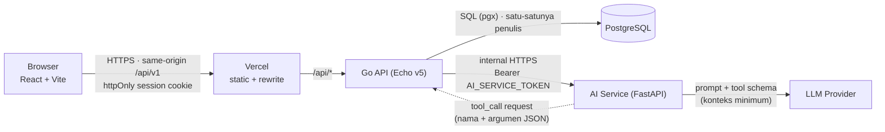

# Architecture Overview

## Context



## Batas tanggung jawab

| Komponen | Memiliki | Tidak boleh |
|---|---|---|
| Frontend | UI, routing, validasi UX, state server via TanStack Query | Menjadi sumber angka; menyimpan token di localStorage |
| Go API | Auth, sesi, tenant context, RBAC, domain logic, transaksi DB, reporting, registry & eksekusi AI tool, rate limit | Mempercayai `store_id`/role/harga dari client |
| PostgreSQL | System of record; FK, CHECK, UNIQUE, ledger immutable | — |
| AI service | Adapter provider, prompt assembly, parsing tool-call, timeout/retry | Koneksi/credential DB, tool mutasi, menyimpan secret pengguna |
| LLM | Memahami intent, merangkai jawaban dari hasil tool | Melihat data di luar hasil tool yang diizinkan |

## Alur request standar (Sprint 1+)

1. `RequestID` → `AccessLog` → `Recover` → `SecurityHeaders` → `BodyLimit` → `CORS` (sudah ada, Sprint 0).
2. `Session` middleware: cookie → hash token → baris `sessions` aktif → `user_id`.
3. `Tenant` middleware: `user_id` → `store_members` → `store_id`, `role` ditaruh di context. **Satu-satunya sumber `store_id`.**
4. `RequireRole(OWNER)` pada route owner-only.
5. Handler tipis → service (aturan bisnis, transaksi) → repository (query selalu dengan `store_id`).

## Alur AI (Sprint 6)

```mermaid
sequenceDiagram
  participant U as User
  participant G as Go API
  participant A as AI Service
  participant L as LLM
  U->>G: POST /assistant/conversations/{id}/messages
  G->>G: auth · tenant · role · rate limit · conversation ownership
  G->>A: prompt + allowlist tool schema (tanpa store_id)
  A->>L: system prompt + pesan + tools
  L-->>A: tool_call(get_sales_summary, {start,end})
  A-->>G: minta eksekusi tool
  G->>G: validasi nama tool ∈ allowlist, schema, rentang tanggal; query ter-scope store_id dari context
  G->>A: hasil tool (ditandai sebagai data, bukan instruksi)
  A->>L: lanjutkan (maks 4 iterasi)
  L-->>A: jawaban final
  A-->>G: jawaban + metadata tool
  G->>G: simpan ai_messages
  G-->>U: jawaban + periode + waktu data
```

`store_id` tidak pernah dikirim ke AI service atau LLM; Go menyisipkannya saat eksekusi tool dari context terverifikasi. Ini membuat kebocoran lintas tenant lewat argumen tool mustahil secara struktural.

## Konsistensi data

- Semua mutasi stok: `BEGIN` → `SELECT … FOR UPDATE` (urut `product_id`) → validasi → `UPDATE products` + `INSERT stock_movements` → `COMMIT`.
- Checkout: langkah PRD §10.2; idempotency via unique `(store_id, idempotency_key)` — request ulang mengembalikan sale yang sudah ada.
- Ledger `stock_movements` append-only (trigger menolak UPDATE/DELETE).

## Observability

Log JSON terstruktur (`log/slog`) dengan `request_id`, tanpa query string, header, password, atau token. `X-Request-Id` diteruskan Go → AI service dan dikembalikan ke browser untuk korelasi laporan bug. Health: `/healthz` (liveness, tanpa dependency) dan `/readyz` (dependency, tanpa detail error).

## Deployment target

Frontend di Vercel dengan rewrite `/api/*` → Go API; Go API & AI service sebagai container terpisah; PostgreSQL managed (Neon). Migration dijalankan sebagai langkah deploy terkontrol, bukan saat startup replica.
