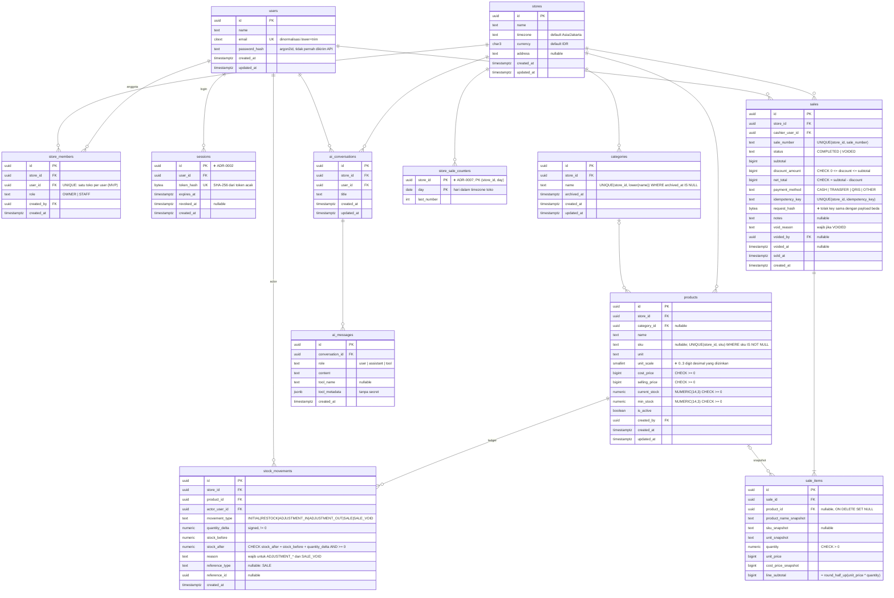

# Initial ERD

Baseline dari PRD §10, dengan tambahan yang dibutuhkan keputusan teknis (ditandai ➕). Nama kolom final ditetapkan di migration tiap sprint; constraint di sini wajib dipertahankan.

## Index minimum (PRD §10.1)

- `products (store_id, is_active)`, `products (store_id, lower(name))`, partial unique SKU.
- `stock_movements (store_id, product_id, created_at DESC)`.
- `sales (store_id, sold_at DESC)`, `sales (store_id, status)`, unique `(store_id, idempotency_key)`.
- `sale_items (sale_id)`, `sale_items (product_id)`.
- `ai_conversations (store_id, user_id, updated_at DESC)`, `ai_messages (conversation_id, created_at)`.

## Status implementasi

| Tabel | Migration | Catatan |
|---|---|---|
| users, stores, store_members, sessions | 00001 (Sprint 1) | sesuai ERD |
| categories, products, stock_movements | 00002 (Sprint 2) | `stock_movements` dibuat lebih awal dari rencana agar stok awal tercatat (ADR-0005). Integritas antar-toko dijaga composite FK `(category_id, store_id)` dan `(product_id, store_id)` |
| sales, sale_items, store_sale_counters | Sprint 4 | — |
| ai_conversations, ai_messages | Sprint 6 | — |

## Kebijakan delete

- Tidak ada `ON DELETE CASCADE` dari `stores`/`products` ke data transaksi atau ledger. Produk diarsip (`is_active = false`).
- `stock_movements` append-only: trigger `BEFORE UPDATE OR DELETE` → `RAISE EXCEPTION`.

## Rounding

`line_subtotal = unit_price × quantity` dibulatkan **half-up ke rupiah terdekat** saat quantity pecahan (mis. 1,5 kg × Rp 12.333 = 18.499,5 → Rp 18.500). Dihitung di Go dengan decimal, bukan float. Perlu konfirmasi (ADR-0005).
